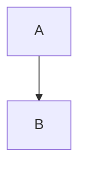
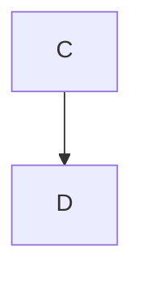

# Rich fixture

```js
const answer = 42;
```

Formula: $\hat{a}$, inline $\sum_{i}^n$, display $$\sum_{i}^n$$, and $\colorbox{red}{x}$. 

<span style="background:url(http://evil.test/a)">hostile style</span>



```mermaid
not a valid diagram !!!
```


