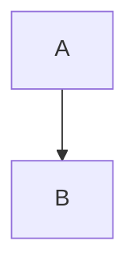

# Plugin fixture

[[TOC]]

## Inserted text

This is ++inserted++ text.

## Table

|             |          Grouping           ||
First Header  | Second Header | Third Header |
 ------------ | :-----------: | -----------: |
Content       |          *Long Cell*        ||
Content       |   **Cell**    |         Cell |

## Math

Inline $E = mc^2$ math.

## Diagram

